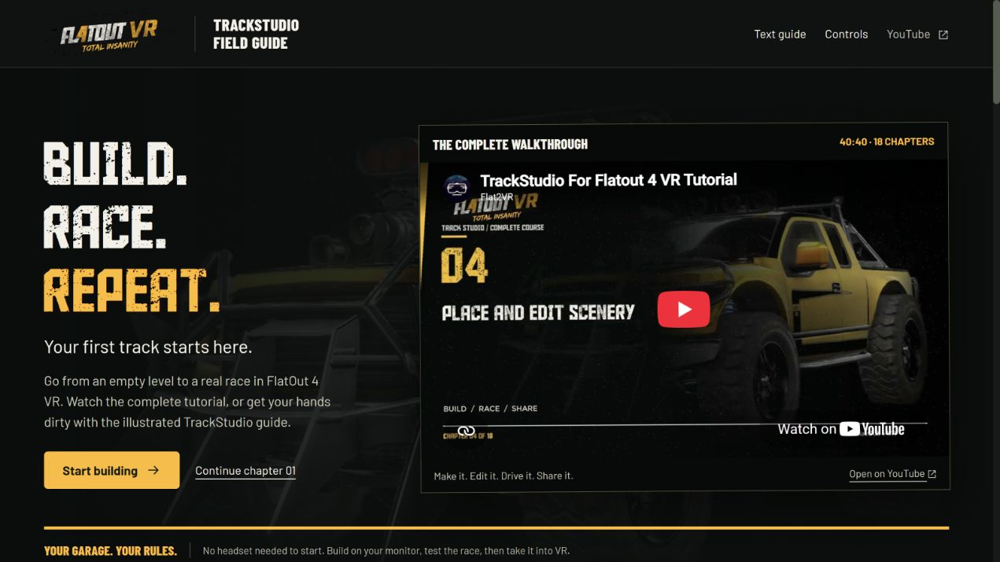

# Track Studio for FlatOut 4 VR

Build a track with the game's own art, race it in FlatOut 4 VR, and share it on the Steam Workshop.

This repository contains **public downloads and the player guide**. The editor's source code is maintained separately and is not published here.

## Get Track Studio

**[Download the TrackStudio 0.2.12 installer for Windows x64](https://github.com/Flat2VRStudios/TrackStudio-Releases/releases/download/v0.2.12/TrackStudio-0.2.12-Setup.exe)** · **[Portable ZIP](https://github.com/Flat2VRStudios/TrackStudio-Releases/releases/download/v0.2.12/TrackStudio-0.2.12-win-x64.zip)** · **[All release files and checksums](https://github.com/Flat2VRStudios/TrackStudio-Releases/releases/latest)**

1. Run **TrackStudio-0.2.12-Setup.exe**. It installs for your Windows account without administrator rights and adds a Start menu shortcut. To stay portable instead, unzip the ZIP into a folder you can write to and keep **TrackStudio.exe**, **README.md** and **App** together.
2. Start **Track Studio**. The **starter content pack is included**; no separate starter download or .NET installation is needed.
3. Check the detected game, content pack and workspace folders, then choose **Start**.

You need your own updated Steam installation of **FlatOut 4 VR**, Windows 10 version 1809 or later (64-bit), and a graphics card supporting Direct3D 11. You do not need a VR headset to build or test on your monitor. The editor download does not include the game or its content compiler.

### New in 0.2.12

- A **Setup installer** with a Start menu shortcut, upgrades and uninstall from Windows Settings. Your tracks, workspace and settings are kept separately and survive an uninstall. The portable ZIP now holds just **TrackStudio.exe**, **README.md** and **App**.
- **Help → Check for updates** finds the next release, verifies its download and installs it after the usual **Save all / Don't save / Cancel**. Startup checks can be turned off in **Help**.
- Crashes and unexpected errors are reported to the developers with your user folder removed from file paths. **Help → Send error reports** turns this off.
- **Actor → Make imported objects editable…** splits merged imported meshes back into their named objects, so one tree of an imported track moves without the others. See [Moving individual imported objects](docs/IMPORTED-OBJECT-EDITING.md).
- Move, rotate and scale handles on imported models sit on their visible geometry, with **Auto**, **Center** and **Origin** pivot choices. **File → Exit** asks to save like the window's close button.
- Fixes: Enter in **Save changes?** presses **Save all**; **Undo** works after changing **Static**; **Duplicate**, **Lay out grid** and prefab edits change nothing when part of them is refused; point-to-point races get no overlapping grid or never-ending RankSpline; **Install in my game** and **Remove from my game** recover from part-finished installs; a Workshop item deleted on Steam can be forgotten; **Import from another game** copes with unreadable files. The full list is in the release notes.

### Included from 0.2.11

- **Save changes?** offers **Save all**, **Don't save** and **Cancel** together, with **Choose files to save…** still available.
- New FBX imports explain and refuse UVs outside the game's supported range before creating materials or geometry, preventing silently clipped textures. Existing stretched models still need their original UVs corrected and rebuilt/reimported.
- The [texture and material XML reference](docs/TEXTURE-MATERIAL-XML.md) explains wrapping, mip filtering and material parameters; the [UV tiling guide](docs/FBX-IMPORT.md#uv-tiling-and-texture-settings) explains the correction.

### Included from 0.2.10

- An Asset Editor **...** pressed while another file browser is open says that a file chosen there isn't used for its field, and the Asset Editor's browsers are titled with the asset's whole path.

### Included from 0.2.9

- File browsers that don't open in your track's folder, such as **Import 3D model**, start in the folder you used last (Documents the first time) instead of Track Studio's install folder.
- The Asset Editor's **...** buttons open the file browser over the Asset Editor; a pick made after the asset changed or the window closed is no longer applied.
- A **Browse** pressed in the main window or an Asset Editor while a file browser is already open brings that browser to the front instead of doing nothing.
- **Rebuild probes** stops if another level is opened while it asks or builds, and in a developer checkout its **Build first?** question names the repair of older imported models.

### Included from 0.2.8

- The modern Windows **Open file** browser, with the address bar, search and navigation sidebar, on its own desktop thread with progress feedback, repeated-click protection, cancellation and reopening.

### Included from 0.2.7

- Probe maps rebuilt by **Ship → Lighting probes → Rebuild probes** now face the right way in the game and in the editor. Tracks with rebuilt probes need **Rebuild probes** and build/export again to pick this up.
- **Rebuild probes** works for workspaces in OneDrive or in a moved Documents folder, and the material repair also handles imports made with no level open and names in mixed case.
- Changing AI marker widths keeps each marker's own blend setting; a custom AI or collision profile set back to 0 no longer blocks **Install**.
- Conversion drafts no longer turn frozen source collision into live collision, convert a model used both with and without its physics, and list the collision they left out.
- Safer **Test in game** saves, recovery from an interrupted prop-pack install, and a clearer message when the game closes before a test race.

See [FBX material import](docs/FBX-IMPORT.md), [moving individual imported objects](docs/IMPORTED-OBJECT-EDITING.md), [custom map policies](docs/CUSTOM_MAP_AI.md) and [track folders and level scripts](docs/TRACK_FOLDERS.md).

Your existing workspace and **0.2.2 full prop pack** can be reused. See the [0.2.12 release notes](https://github.com/Flat2VRStudios/TrackStudio-Releases/releases/tag/v0.2.12).

## Learn Track Studio

**[Watch the full video tutorial (40 minutes)](https://youtu.be/LvMekSUe_pw)** · **[Follow the illustrated, interactive guide](https://gistpreview.github.io/?9c12eb4549742e2019ff128acefdf0b7)**

The 18 chapters cover project setup, navigation, scenery, roads, terrain, vegetation, race systems, custom assets, lighting, validation, building, a real in-game race, iteration, Steam Workshop publishing, learning from existing maps, MCP automation, and backups. The text guide includes screenshots, practice tasks, quizzes and progress saved in your browser.

## Optional full prop pack

The starter pack is enough for the first-track workflow. The optional **0.2.2 full prop pack remains compatible with 0.2.12**; it does not need to be downloaded again. For the larger scenery catalogue, download **all nine matching 0.2.2 parts** into one folder. The full pack is about **9.8 GB to download / 13.4 GB installed**. Keep extra space for the downloaded ZIPs until installation is complete.

[Part 1](https://github.com/Flat2VRStudios/TrackStudio-Releases/releases/download/v0.2.2/TrackStudio-PropPack-0.2.2-part1-of-9.zip) | [Part 2](https://github.com/Flat2VRStudios/TrackStudio-Releases/releases/download/v0.2.2/TrackStudio-PropPack-0.2.2-part2-of-9.zip) | [Part 3](https://github.com/Flat2VRStudios/TrackStudio-Releases/releases/download/v0.2.2/TrackStudio-PropPack-0.2.2-part3-of-9.zip) | [Part 4](https://github.com/Flat2VRStudios/TrackStudio-Releases/releases/download/v0.2.2/TrackStudio-PropPack-0.2.2-part4-of-9.zip) | [Part 5](https://github.com/Flat2VRStudios/TrackStudio-Releases/releases/download/v0.2.2/TrackStudio-PropPack-0.2.2-part5-of-9.zip) | [Part 6](https://github.com/Flat2VRStudios/TrackStudio-Releases/releases/download/v0.2.2/TrackStudio-PropPack-0.2.2-part6-of-9.zip) | [Part 7](https://github.com/Flat2VRStudios/TrackStudio-Releases/releases/download/v0.2.2/TrackStudio-PropPack-0.2.2-part7-of-9.zip) | [Part 8](https://github.com/Flat2VRStudios/TrackStudio-Releases/releases/download/v0.2.2/TrackStudio-PropPack-0.2.2-part8-of-9.zip) | [Part 9](https://github.com/Flat2VRStudios/TrackStudio-Releases/releases/download/v0.2.2/TrackStudio-PropPack-0.2.2-part9-of-9.zip)

In the editor, open **Prefabs → Install downloaded parts…** and select **any one** of the parts. The other eight are found beside it. Do not mix parts from different versions. If a level was open during installation, restart TrackStudio afterward.

## Your first track

1. Choose **New level**, give it a unique name such as `MY_TRACK`, and select the **Race track** template. Keep at least eight starting slots for a released track.
2. Hold **RMB + WASD** to fly; **Q / E** move down / up and the mouse wheel changes speed. Release RMB before using editing shortcuts. **Home** frames everything; **F** frames the selection.
3. Place props from **Prefabs**. **Q / W / E / R** select, move, rotate and scale. **Ctrl+D** duplicates, **End** drops to ground, and **Ctrl+Z** undoes.
4. Use **Draw road** to place control points. **Enter** finishes a road; **Esc** leaves the tool. Fit the terrain separately, and align the AI route, checkpoint gates, grid and recovery volumes with the road.
5. Save with **Ctrl+S**, run **Track → Validate**, read the findings, then choose **Ship → Build level** and **Ship → Test in game**. Test start positions, collision, opponents, checkpoint progression, recovery and the finish.
6. When the track works, use **Ship → Publish to Steam Workshop** or **Ship → Share as a file**. Preserve your editable workspace and Workshop association data for future updates.

The first road build can temporarily require free disk space about the size of the installed game. Saving editable sources and building game content are separate steps.

## Existing and imported maps

Open installed FlatOut 4 VR tracks without a game source checkout. Use **Save copy as new level** to create an editable workspace copy. Compatible maps from other games can be inspected and assembled into conversion drafts; a draft does not certify a complete playable port.

## Game compatibility

Track-folder racing and the Workshop upload/download round trip were validated on FlatOut 4 VR release-candidate build **26434887**. Track-folder racing on Steam public build **26352498** has not yet been verified. Use a game version supporting modded tracks and check the editor's readiness messages before sharing a level.

The full player guide and release notes are also included with the editor, in its **App** folder.
